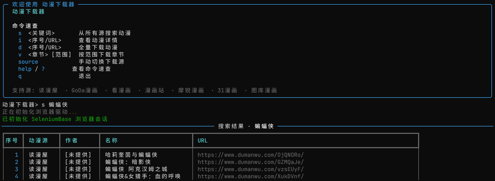
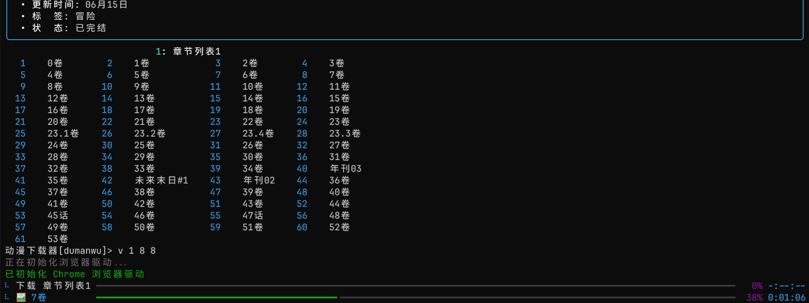
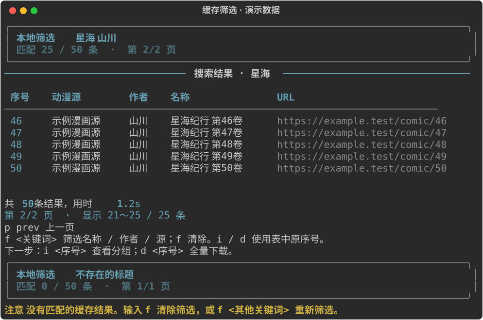
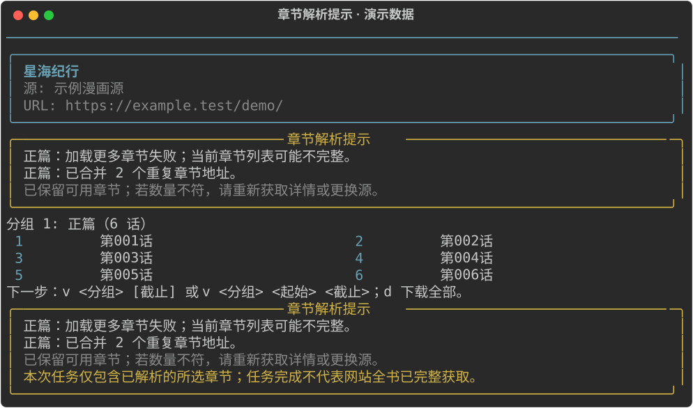
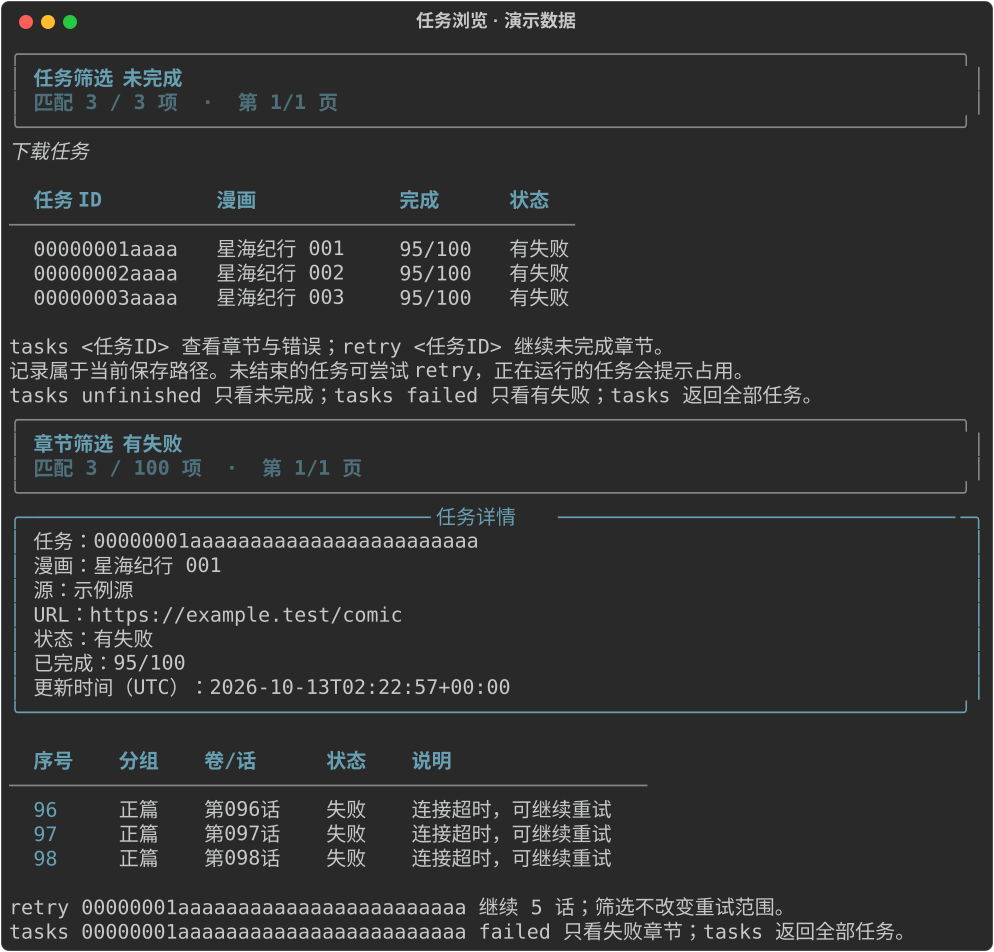
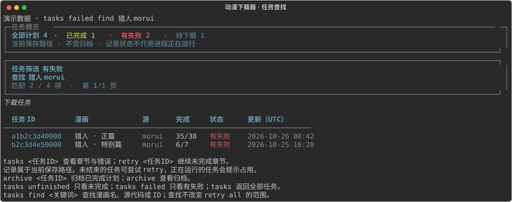
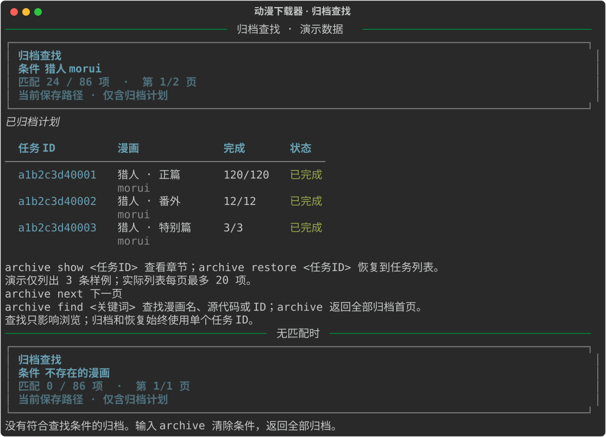
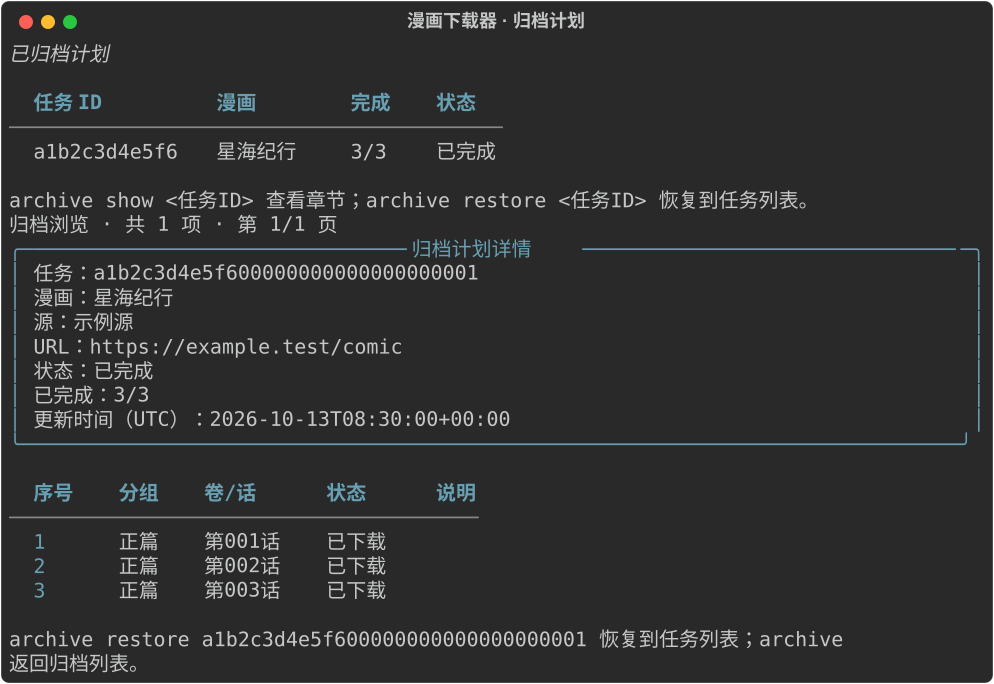

# 动漫下载器

[](https://deepwiki.com/fjcanyue/comic_downloader)

轻量级动漫下载器，提供带状态反馈的交互式终端界面。支持多源并行搜索、按章节下载、断点复用，以及三种页面加载模式；请求被站点屏蔽时可自动回退到浏览器模式。

## 支持的网站

| 网站 | 状态 | 浏览器模式 |
|------|------|------------|
| [摩锐漫画](https://www.morui.com) | ✅ 可用 | SeleniumBase / CloakBrowser  |
| [读漫屋](https://www.dumanwu.com) | ✅ 可用 | requests |
| [漫画柜/看漫画](https://www.manhuagui.com) | ✅ 可用 （境外） | requests |
| [漫画站](https://www.manhuazhan.org) | ✅ 可用 | requests |
| [31漫画](https://www.thmh.com) | ✅ 可用 | requests |
| [图库漫画](https://www.tuku.cc) | ✅ 可用 | requests |
| [GoDa漫画](https://manhuafree.com) | ✅ 可用 | requests |

 

## 浏览器模式

工具支持三种 HTML 解析方式，按源的配置自动切换：

| 模式 | 说明 | 是否需要浏览器驱动 |
|------|------|-------------------|
| **requests** | 使用 HTTP 请求直接获取 HTML | 否 |
| **SeleniumBase** | 使用 SeleniumBase CDP 模式渲染页面 | 是 |
| **CloakBrowser** | 使用 CloakBrowser 反爬浏览器，可能需要人工介入 | 是 |

> **自动回退**: 当 requests 模式收到 HTTP 403/429 时，会自动切换到 SeleniumBase 模式重试。

## 快速开始

### 运行二进制文件

从 [Releases 页面](https://github.com/fjcanyue/comic_downloader/releases/latest) 下载 `comic_downloader.exe`：

```shell
comic_downloader <下载路径>
```

不传路径时默认保存到当前目录。

### 从源码运行

```shell
uv sync
uv run main.py <下载路径>
```

### 打包

```shell
uv run pyinstaller downloader.spec
```

## 使用说明

### 交互式命令

启动后进入交互式 shell，支持以下命令：

| 命令 | 说明 | 示例 |
|------|------|------|
| `s <关键词>` | 从所有启用的源中搜索动漫 | `s 猎人` |
| `f [关键词]` | 按名称、作者或源筛选缓存；不填清除筛选 | `f 猎人 morui` |
| `p [页码/next/prev]` | 翻看筛选后的搜索结果，每页 20 条；不填重显当前页 | `p next` |
| `i <序号/URL>` | 查看动漫详情（章节列表） | `i 1` 或 `i https://...` |
| `ch <分组> [页码/next/prev]` | 翻看当前漫画章节，每页 60 话；记住各分组当前页 | `ch 1 next` |
| `d <序号/URL>` | 全量下载动漫 | `d 12` 或 `d https://...` |
| `v <参数>` | 按范围下载章节 | `v 1` `v 1 12` `v 1 5 10` |
| `source [序号/代码名/名称]` | 切换下载源；无参数时显示菜单，回车或 q 取消 | `source morui` |
| `sources` | 查看动漫源能力及浏览器依赖 | `sources` |
| `check [序号/代码名/all]` | 查看已存状态，或显式检查来源 | `check all` |
| `status` | 查看路径、当前漫画、搜索结果数和覆盖模式 | `status` |
| `tasks [状态] [页码]` | 按状态浏览下载计划，每页 20 项 | `tasks unfinished` |
| `tasks [状态] [页码] find <关键词>` | 按漫画名、源代码或 ID 查找计划 | `tasks failed find 猎人 morui` |
| `tasks <任务ID> [状态] [页码]` | 查看某个计划的章节与错误，每页 30 话 | `tasks a1b2c3d4 failed` |
| `tasks next` / `tasks prev` | 在当前任务列表或章节筛选中连续翻页 | `tasks next` |
| `archive <任务ID>` | 归档一个已完成计划，保留漫画文件 | `archive a1b2c3d4` |
| `archive [list [页码]]` | 查看已归档计划，每页 20 项 | `archive list 2` |
| `archive [list [页码]] find <关键词>` | 按漫画名、源代码或 ID 查找归档 | `archive find 猎人 morui` |
| `archive next` / `archive prev` | 保留归档查找条件或当前详情，连续翻页 | `archive next` |
| `archive show <任务ID> [页码]` | 查看归档详情，每页 30 话 | `archive show a1b2c3d4 2` |
| `archive restore <任务ID>` | 将归档计划恢复到任务列表 | `archive restore a1b2c3d4` |
| `retry [序号/任务ID/all]` | 查看或继续未完成下载，支持重启后恢复 | `retry a1b2c3d4` |
| `help [命令]` | 命令速查和具体用法 | `help v` |
| `q` | 退出 | `q` |

 

 

### `v` 命令三种模式

1. `v <章节序号>` — 下载该章节下的所有话
2. `v <章节序号> <截止序号>` — 从章节开始到截止序号
3. `v <章节序号> <起始序号> <截止序号>` — 指定起始到截止范围

详情表中的“分组”对应这里的章节序号，所有序号从 **1** 开始，范围包含截止话。
`d` 不传参数时下载当前查看的漫画。切换源或重新请求详情后，旧详情会失效，
请使用 `i <序号/URL>` 加载后再下载。`source` 只切换下载源，`s` 始终搜索所有启用源。

交互式 shell 中直接回车不会重复执行上一条命令。输入 `q` 或 EOF 退出
（Windows 为 Ctrl+Z 后回车，Unix 为 Ctrl+D）。解析或网络异常会显示错误并返回提示符。
窄终端中的搜索结果优先展示序号、源和名称，作者与 URL 可通过 `i` 查看。

搜索过程中逐源更新完成数量；结束后显示各源的结果数、耗时和错误原因，`status` 可再次查看。
报告区分“有结果”“未检出”“部分结果”“失败”和“跳过”。已知需要搜索验证码的漫画站会
提示改用完整漫画 URL；“未检出”仅表示本次没有找到条目，不代表站点一定正常。

搜索保留各源本次返回的全部条目，不再只取前 10 条。`p 2` 查看第 21～40 条，
之后仍使用 `i 21` 选择原序号；`ch 1 2` 查看第 1 分组的第 61～120 话，
例如使用 `v 1 61 65` 下载其中的第 61～65 话。翻页读取会话缓存，不重新请求网站，
也不会自动抓取网站的后续搜索页。重新搜索后结果缓存更新。

### 本地筛选与连续翻页

搜索后可以继续缩小结果范围，无需重复访问网站：

```text
s 猎人
f morui             按源代码筛选，也支持中文源名称
f 猎人 富坚         名称、作者、源中同时包含这两个词
p next              查看筛选结果的下一页
p prev              返回上一页
p                   重显当前页
f                   清除筛选，回到全部结果第一页
```

`f` 按空白分词、忽略大小写，所有词都必须匹配；每次筛选都作用于最近一次搜索的全部缓存，
不是在上一轮筛选上叠加。筛选面板显示条件、匹配数和页码，无匹配时可以直接输入 `f` 恢复。
**结果序号始终对应原始搜索列表**：筛选后显示 `46`，仍使用 `i 46` 或 `d 46`，不会变成 `i 1`。
筛选只影响浏览；`d` 不带参数仍下载当前漫画，不会批量下载筛选列表。`status` 可查看当前筛选与页码。

查看详情后，`ch 1 next` / `ch 1 prev` 连续翻看第 1 分组，`ch 1` 重显该分组当前页。
切换分组不会丢失其页码，重新加载漫画详情后各分组回到第一页。第一页向前、最后一页向后
会提示边界并保留当前状态。`f`、`p`、`ch` 仅用于交互式会话。

搜索结果使用简洁的横向表头，窄屏保留序号、源和名称；帮助面板在窄终端改为两列换行，
避免命令说明被省略。以下为实际 Rich 渲染的演示数据，不代表在线搜索结果：



### 章节解析提示与目录完整性

查看详情时，如果部分章节缺少名称或地址、追加章节请求失败，或目录中出现重复地址，
界面会显示“章节解析提示”。解析器保留其余可用章节；分组标题缺失时，共用分组解析器
会使用默认名称保留章节。没有解析到任何可下载章节时，会明确提示检查页面或源适配。

默认启用的 7 个源统一校验 HTTP/HTTPS 章节地址，正确处理相对路径、完整地址和
`//` 开头的地址，并读取嵌套标签中的标题文字。同一分组内相同地址只保留一次，
维持该源解析后的章节顺序；不同分组中的相同地址继续保留。

有解析提示时，下载前会再次显示说明：**任务完成只表示已解析并选入计划的章节处理完成，
不代表网站全书已经完整获取**。若章节数量不符，请重新执行 `i <序号/URL>` 获取详情，
或更换源后创建新计划；`retry` 只恢复已有计划，不会补抓目录中未解析到的章节。
解析提示属于本次详情会话，不写入历史任务记录；已有任务格式保持兼容。

以下为实际 Rich 渲染的演示数据，展示详情及下载前的提示：



### 直接子命令

不进入交互式 shell，直接执行：

```shell
comic_downloader search <关键词>
comic_downloader info <URL>
comic_downloader download <URL>
comic_downloader download_vols <URL> <章节序号> [起始] [截止]
comic_downloader tasks [状态] [页码]
comic_downloader tasks [状态] [页码] find <关键词>
comic_downloader tasks <任务ID> [状态] [页码]
comic_downloader archive [list [页码]]
comic_downloader archive [list [页码]] find <关键词>
comic_downloader archive <任务ID>
comic_downloader archive show <任务ID> [页码]
comic_downloader archive restore <任务ID>
comic_downloader retry [任务序号|任务ID|all]
comic_downloader sources
comic_downloader check [动漫源序号|代码名|all]
```

直接子命令没有上一次搜索的会话状态，`info` / `download` 必须使用完整 URL。
直接 `search` 和 `info` 输出完整列表；`p` / `ch` 仅用于交互会话。
`download_vols <URL> 1 10` 下载第 1 分组的前 10 话，
`download_vols <URL> 1 5 10` 下载第 5～10 话。

退出码：`0` 表示成功（搜索正常完成但无结果也为 0）；`1` 表示执行或配置失败，
包括下载部分失败、没有下载任何章节、所有搜索源均失败或跳过；`2` 表示参数错误；
`130` 表示 Ctrl+C 中断。搜索至少有一个源完整执行成功即返回 0；只有部分结果且没有
任何完整成功的源时返回 1，已解析的条目仍会显示。各源错误单独报告。

### 下载任务与恢复

每次 `d` / `v`（或 `download` / `download_vols`）在获取章节计划后自动保存任务，
显示任务 ID，并在每话处理结束后更新进度。输入 `tasks` 查看记录，
`tasks <任务ID>` 查看各话状态与错误，`retry <任务ID>` 继续失败、部分失败或未开始的章节。
成功与已跳过的章节不会再次执行；未完成章节中的已有图片默认继续复用。

重启后使用**相同的保存路径**即可恢复，无需重新搜索、获取漫画详情或输入范围。例如：

```shell
comic_downloader D:\Comics tasks
comic_downloader D:\Comics retry a1b2c3d4
```

将示例 ID 换成 `tasks` 中显示的 ID，也可以使用至少 4 位且不重复的前缀。
任务记录位于保存路径下的 `.comic_downloader/jobs/`。相同任务同时运行时会提示占用；
进程退出后系统会释放锁。记录损坏时会显示错误，其余任务仍可查看。

`retry` 使用当前运行配置和覆盖选项，但只作用于未完成章节。
若要重新下载已经完成的章节，使用 `--overwrite` 重新执行 `download` / `download_vols` 创建新任务。
任务记录不是文件校验清单：手动删除已经完成的文件后，应创建新下载任务。

### 任务分页与状态筛选

`tasks` 返回全部下载计划的第一页，按更新时间从新到旧排列；同一时间的记录按任务 ID
稳定排序。列表每页 20 项，详情每页 30 话，交互与直接子命令都默认只显示第一页：

```text
tasks unfinished               查看还有未完成章节的计划
tasks failed 2                 查看有失败计划的第 2 页
tasks a1b2c3d4 failed           只看该计划失败或部分失败的章节
tasks next                     沿用当前列表、任务及筛选，查看下一页
tasks prev                     返回上一页
tasks                          返回全部任务首页
```

将示例 ID 替换为实际任务 ID。筛选支持：

| 状态 | 任务列表 | 任务详情中的章节 |
| --- | --- | --- |
| `all` | 全部计划 | 全部章节 |
| `unfinished` | 仍有未完成章节 | 待下载、失败或部分失败 |
| `failed` | 记录状态为“有失败” | 失败或部分失败 |
| `completed` | 记录状态为“已完成” | 已下载或已跳过 |
| `pending` | 记录状态为“待下载” | 尚无处理结果 |
| `running` / `interrupted` | 未结束 / 已中断 | 不适用 |

`running` 是保存的任务状态，并不保证进程仍在运行；`unfinished` 根据剩余章节计算。
筛选和分页只改变展示，**`retry <任务ID>` 仍恢复该计划的所有未完成章节**。
详情中的序号是该计划的原章节位置，跨分组连续编号，不是 `v` 命令的分组内序号。
任务继续通过 ID 选择；纯数字 ID 前缀也按 ID 处理，例如 `tasks 1234`，
查看全部任务的第 2 页应输入 `tasks all 2`。

直接子命令没有连续浏览会话，必须使用明确页码，例如：

```shell
comic_downloader D:\Comics tasks unfinished 2
comic_downloader D:\Comics tasks a1b2c3d4 failed 2
```

输出会提供下一页的明确命令；`tasks next/prev` 仅在交互会话中可用。
列表显示的短 ID 遇到冲突会自动加长；打开详情后使用完整 ID 记住当前任务。
无匹配、越界和损坏记录都有提示，有效记录仍可浏览。

任务列表采用内存中的轻量摘要缓存，不额外写入索引文件，也不修改任务 JSON 格式。
每次浏览仍扫描文件元数据，新增、删除及正常更新/原子替换的记录会反映在后续浏览中；
内容变化时重新解析，详情与重试始终读取任务记录。首次扫描仍需验证所有历史计划，
缓存只在当前进程内有效。列表会实时刷新，其他下载更新任务时排序和页内内容可能变化，
任务 ID 保持不变。以下为真实 Rich 输出的演示数据：



### 按名称查找任务与状态概览

历史计划较多时，可以把状态筛选与名称查找组合使用：

```text
tasks find 猎人                    查找漫画名中包含“猎人”的计划
tasks failed find 猎人 morui       只看该漫画在 morui 源的失败计划
tasks next                        保留状态与关键词，查看下一页
tasks prev                        返回上一页
tasks all 2 find 猎人              明确查看匹配结果第 2 页
tasks find a1b2                    按 ID 片段查找，再用完整或唯一前缀打开详情
tasks                             清除条件，返回全部任务首页
```

`find` 后的全部文字都是关键词，按空白分词、忽略大小写且必须全部匹配；匹配字段为
漫画名、源**代码名**及任务 ID，不搜索章节或归档内容。关键词不需要引号，多个词可以
分别命中不同字段。数字也可作为关键词；明确指定页码时须先写状态，例如 `tasks all 2 find 猎人`。
`tasks find` 缺少关键词会提示用法，不会清除已有查询。新查询从第一页开始，越界时保留
原查询和页码；显式指定页码时使用指定页。每次浏览都会刷新记录，所以其他进程的更新可能改变排序和页数。

直接子命令同样支持查找，例如 `comic_downloader D:\Comics tasks failed 2 find 猎人 morui`，
输出的前后页命令会带上查询条件。查找只改变浏览结果，**`retry all` 仍恢复当前保存路径下
全部未完成任务**，不会只重试查找结果；单个计划请使用 `retry <任务ID>`。

任务概览显示当前路径中全部有效、未归档计划的状态数量，统计不随查找条件改变；无法读取的
记录单独计数，不会伪装成下载失败。下方显示当前状态、关键词、匹配数量与页码。列表在宽终端
展示来源及 UTC 更新时间，在窄终端把来源放在漫画名下方，并保留 ID、状态和完成数。

未变化的损坏 JSON 也会缓存错误摘要，避免连续翻页时重复解码；错误仍逐次报告。
缓存不保留异常堆栈或章节内容，文件变更后重新读取，删除后清除；临时 I/O 错误不缓存。
首次扫描与每次元数据扫描仍有开销，缓存只对当前进程有效。以下是实际 Rich 渲染的演示数据：



ZIP 完整写入临时文件后才替换最终文件，已有 ZIP 需通过可读性、非空与 CRC 校验才会跳过。
打包只包含本次预期的编号图片，目录中的笔记和临时文件会保留在原地。

### 已完成计划归档与恢复

历史计划较多时，使用 `archive <任务ID>` 将一个**已完成计划**移出主任务列表。
归档只移动计划记录，保留原始 ID、时间、章节结果和漫画文件；需要查看时进入归档列表，
也可以随时恢复：

```text
tasks completed                  找到要归档的已完成计划
archive a1b2c3d4                  归档一个计划
archive                           查看归档第一页
archive list 2                    查看归档第 2 页
archive find 猎人 morui           查找该漫画在 morui 源的归档
archive next                      保留条件，查看下一页
archive prev                      返回上一页
archive list 2 find 猎人 morui    明确查看查找结果第 2 页
archive show a1b2c3d4              查看该归档计划的章节
archive show a1b2c3d4 2            查看第 31～60 话
archive restore a1b2c3d4           恢复到主任务列表
```

将示例 ID 替换为实际 ID，支持至少 4 位且不重复的十六进制前缀，包括纯数字前缀。
归档列表每页 20 项，详情每页 30 话，按原更新时间从新到旧排列；归档和恢复不会重写
更新时间。交互模式支持 `archive next/prev`，沿用最近成功打开的归档列表或章节详情；
详情会记住完整 ID，避免前缀后来出现冲突。直接子命令使用明确页码，输出的翻页命令带上关键词。

查找按空白分词、忽略大小写，所有词必须在漫画名、源代码或 ID 中匹配，可以跨字段命中。
`find` 后所有文字均为关键词；不搜索章节，不访问网站。新查询默认回到第一页，
`archive` 或 `archive list` 清除条件，返回全部归档首页。参数错误和越界不会覆盖原查询；
归档和恢复单个计划也不会清除查询。列表每次读取当前记录，其他进程恢复计划后页数可能缩减，
此时可使用 `archive list 1 find <原关键词>` 或 `archive` 重新定位。

查找面板显示条件、匹配数、全部可读归档数和页码；无法读取的记录单独计数并报告，
不会混入匹配总数。无匹配时提供清除条件的入口。**查找只影响浏览，归档和恢复始终指定单个 ID**，
不把当前列表当作批量操作范围。短 ID 按全部可读归档判断冲突，不因筛选而缩短。

以下为实际 Rich 渲染的合成演示数据，展示查询反馈与空结果提示：



直接执行时同样使用原来的下载路径：

```shell
comic_downloader D:\Comics archive a1b2c3d4
comic_downloader D:\Comics archive list 2
comic_downloader D:\Comics archive list 2 find 猎人 morui
comic_downloader D:\Comics archive restore a1b2c3d4
```

归档记录位于 `<下载路径>/.comic_downloader/jobs/archive/`，从 `tasks` 和计划重试入口
移出；恢复后仍是已完成状态，不会自动重新下载。归档不改变独立章节恢复记录
`tasks.json`，也不校验或删除漫画文件。计划状态为待下载、未结束、已中断或有失败时，
请先完成下载再归档；异常退出后已保存全部章节但状态未结束的计划可先 `retry <任务ID>`
完成状态收尾。

归档和恢复共用下载任务的进程锁，任务被占用时会拒绝操作。相同 ID 的目标记录已存在时
不会覆盖；损坏记录会报告错误，其余归档仍可查看。归档没有自动到期或批量删除规则，
也不会释放漫画文件所占空间。以下为实际 Rich 渲染的演示数据：



### 动漫源概览

在交互式 Shell 中输入 `sources`，或直接运行 `comic_downloader sources`，可以查看当前运行配置实际启用的动漫源。概览会展示：

- 当前选中的动漫源；
- 源代码名，可用于 `source <代码名>` 快速切换；
- 页面使用 HTTP、SeleniumBase 还是 CloakBrowser 加载；
- 搜索和下载阶段是否需要浏览器；
- 搜索、详情和下载能力是否受支持；
- 最近一次显式验证的状态和日期；未运行验证时明确显示“未检查”。

输入 `source` 会在同一张能力表下进入选择模式；也可以使用序号、代码名或中文名称直接切换，例如 `source 2`、`source morui`、`source 摩锐漫画`。表格会根据终端宽度自动精简列，状态反馈使用兼容 Windows GBK 控制台的文字标签。

源注册表通过 `SourceCapabilities` 明确描述搜索、详情和下载能力，并使用
`SourceVerification` 表达“未检查、正常、受限、不可用”及最近验证时间。历史 HTML
职责已拆分为页面加载、XPath/JavaScript 提取和 SeleniumBase 诊断模块；项目级 Pyright
检查当前为零错误、零警告，使新增或修复站点适配器时更容易发现接口漂移。

### 来源连通性检查与诊断

`sources` 和不带参数的 `check` 只读取本地记录，不会自动访问任何站点，也不会把“已配置”
显示成“当前在线”。只有执行 `check <序号/代码名>` 或 `check all` 时，下载器才会显式并发访问
所选来源的首页：

- HTTP 2xx/3xx 记为“正常”；
- 能建立连接但返回 HTTP 4xx/5xx 记为“受限”，例如反爬挑战或服务端错误；
- DNS、连接、TLS 或超时错误记为“不可用”。

检查摘要会展示 HTTP 状态、耗时、检查时间和诊断消息。最近一次结果使用原子替换写入
`<下载目录>/.comic_downloader/source-verifications.json`，其中还保留最终 URL、错误类型和
UTC 时间戳，便于脚本或故障排查读取。该检查只验证首页的 HTTP 连通性，不等同于搜索、
详情解析或下载流程的端到端健康检查。

### 下载完整性与任务恢复

下载器不会再把“文件存在”直接等同于“下载成功”：

- 新下载内容在替换正式文件前会检查图片格式和完整性，HTTP 200 返回的 HTML 拦截页、空文件和常见截断文件会进入重试与失败汇总；
- `--overwrite` 未启用时，已有图片只有通过 JPEG、PNG、GIF、WebP、BMP、TIFF 或 AVIF/HEIF 容器检查才会复用，损坏文件会重新下载；
- 已有 ZIP 在跳过前会校验归档结构、内部路径、CRC 和图片内容，损坏归档会重新生成；
- 每个章节从解析开始就在 `<下载路径>/.comic_downloader/tasks.json` 中留下原子写入的任务记录，程序中断、解析失败和图片部分失败都可以跨进程恢复；
- 任务只保存相对于下载根目录的路径，重试时会重新验证任务所属源、URL 域名和目标路径。

输入 `retry` 可以查看待恢复的下载计划和章节记录。`tasks` 中的下载计划使用任务 ID
（或至少 4 位的不重复前缀）恢复；章节记录支持 `retry 1` 或 `retry <章节任务ID>`。
`retry all` 先恢复未完成的下载计划，再恢复独立章节记录，同一次命令不会重复执行计划中
已尝试的章节。重试会重新解析章节页面，并复用已通过完整性检查的图片。

图片下载采用滚动调度：最多保留有效工作线程数两倍的未处理任务，避免长章节一次性创建
大量 Future。任一图片完成后即补充任务，慢图片不会阻塞其他线程继续下载；原有站点限速、
浏览器串行访问、图片复用及中断恢复逻辑继续生效。HTTP 错误响应会在重试前关闭，失败明细
按图片原序号排列。该优化主要降低调度内存占用，实际下载速度仍取决于站点与网络。

### 选项

| 选项 | 说明 |
|------|------|
| `-d`, `--debug` | 输出调试日志到终端 |
| `-c <文件>`, `--config <文件>` | 指定运行配置文件，可覆盖启用源和源的 `browser_mode` |
| `--overwrite` | 覆盖已存在的下载文件 |
| `-h`, `--help` | 显示帮助 |

运行配置示例见 `configs/runtime.sample.json`。配置中的 `sources.<源名>.enabled`
会覆盖 `downloader/sources/registry.py` 中的默认启用状态；`sources.<源名>.browser_mode`
会写入该源的 `SourceProfile`，优先级高于单站点 `configs/*.json` 中的
`browser_mode`，但不会修改源类本身。

## 要求

- Python >= 3.10
- 下载需要浏览器驱动时：Firefox + Gecko Driver / Chrome

搜索和查看详情等不依赖浏览器的命令可直接运行，无需预先安装浏览器驱动。

## 迭代方向

项目按以下顺序继续演进：

1. **终端体验与源透明度（已完成）**：已统一欢迎页、帮助、搜索结果和下载汇总的视觉层级，并提供源能力概览与快速切换。
2. **下载可靠性（已完成）**：已实现图片与 ZIP 完整性校验、跨进程任务记录，以及按任务或批量失败重试入口。
3. **源可维护性（已完成）**：已补齐源能力与最近验证元数据，拆分历史解析和诊断职责，并将项目级 Pyright 类型检查收敛到零错误、零警告。
4. **可观测性（已完成）**：已增加可选的并发源连通性检查、原子持久化的结构化诊断摘要；在线状态只由显式检查产生，不把“已配置”误报为“当前可用”。
5. **长列表操作与调度内存（已完成）**：加入本地多词筛选、稳定序号、连续翻页、分组页码记忆及窄屏帮助；图片队列改为有上限的滚动调度。详见[本轮代码分析、验证与后续方向](docs/ideation/2026-10-13-filter-navigation-performance.md)。
6. **任务浏览规模化（已完成）**：加入计划和章节的状态筛选、分页、稳定 ID 与窄屏详情；轻量摘要缓存减少重复 JSON 解析。详见[任务浏览迭代与性能验证](docs/ideation/2026-10-13-task-browser.md)。
7. **章节目录解析与离线回归（已完成）**：为 7 个默认启用源建立合成详情/API 样本，修复嵌套文本、地址拼接和分组匹配，保留部分可用章节并显示解析提示；追加章节请求限定在所属分组。详见[章节目录解析迭代与验证](docs/ideation/2026-10-13-source-catalog.md)。
8. **已完成计划归档（已完成）**：新增按 ID 归档、归档分页、章节详情与恢复入口，保留任务内容及漫画文件，复用任务进程锁。详见[归档设计与验证](docs/ideation/2026-10-13-job-archive.md)。
9. **任务查找与状态概览（已完成）**：新增漫画名、源代码及 ID 多词查找，保留条件翻页；以状态概览、来源和更新时间改善浏览层级，并缓存未变化的损坏记录错误。详见[代码分析、界面设计与性能验证](docs/ideation/2026-10-26-task-find.md)。
10. **归档查找与连续浏览（已完成）**：归档支持多词查找、独立浏览状态、列表与章节连续翻页；增加查询面板、无匹配恢复入口和损坏记录计数。详见[归档浏览迭代与验证](docs/ideation/2026-10-27-archive-find.md)。

后续优先方向：

- **源解析回归扩展**：已有合成目录样本不代表线上站点当前可用；后续积累有采集日期和来源记录的真实脱敏搜索/详情/章节快照，并扩展图片解析回归。
- **历史任务管理扩展**：已完成任务与归档查找、状态概览、单计划归档与恢复；后续优先评估批量操作候选预览及执行时复核，再设计保留期限及显式清理流程。
- **搜索范围扩展**：依据各源分页协议按需加载网站后续搜索页，并设计去重、限速与稳定序号策略。

开发验证：`uv run pytest -o addopts= -q`；类型检查在 Windows 可使用
`uv run pyright --pythonpath .venv\Scripts\python.exe`，确保检查器解析到项目虚拟环境。
