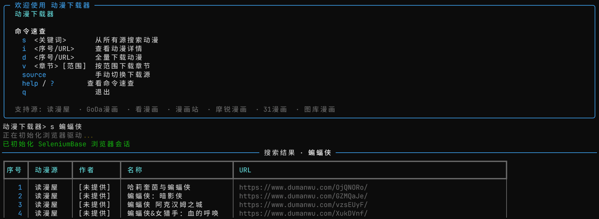
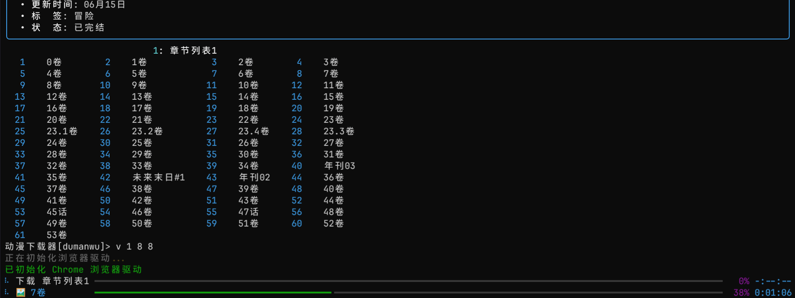

# 动漫下载器

[](https://deepwiki.com/fjcanyue/comic_downloader)

轻量级动漫下载器，提供带状态反馈的交互式终端界面。

主要功能：

- 多源并行搜索，结果统一编号浏览
- 按整本、整卷、单话或连续多话下载
- 任务记录跨进程恢复，已下载内容自动复用
- 图片与 ZIP 完整性校验，损坏文件自动重新下载
- 请求被站点屏蔽时可自动回退到浏览器模式


## 支持的网站

| 网站 | 状态 | 浏览器模式 |
|------|------|------------|
| [摩锐漫画](https://www.morui.com) | ✅ 可用 | SeleniumBase / CloakBrowser |
| [读漫屋](https://www.dumanwu.com) | ✅ 可用 | requests |
| [漫画柜/看漫画](https://www.manhuagui.com) | ✅ 可用（境外） | requests |
| [漫画站](https://www.manhuazhan.org) | ✅ 可用 | requests |
| [31漫画](https://www.thmh.com) | ✅ 可用 | requests |
| [图库漫画](https://www.tuku.cc) | ✅ 可用 | requests |
| [GoDa漫画](https://manhuafree.com) | ✅ 可用 | requests |

### 页面加载模式

工具按源的配置使用三种 HTML 获取方式：

| 模式 | 说明 | 是否需要浏览器驱动 |
|------|------|-------------------|
| **requests** | 使用 HTTP 请求直接获取 HTML | 否 |
| **SeleniumBase** | 使用 SeleniumBase CDP 模式渲染页面 | 是 |
| **CloakBrowser** | 使用 CloakBrowser 反爬浏览器，可能需要人工介入 | 是 |

> **自动回退**：requests 模式收到 HTTP 403/429 时，会自动切换到 SeleniumBase 模式重试。

## 快速开始

### 运行二进制文件

从 [Releases 页面](https://github.com/fjcanyue/comic_downloader/releases/latest) 下载 `comic_downloader.exe`：

```shell
comic_downloader <下载路径>
```

不传路径时默认保存到当前目录。

### 从源码运行

```shell
uv sync
uv run main.py <下载路径>
```

### 打包

```shell
uv run pyinstaller downloader.spec
```

## 基本使用流程

启动后进入交互式 shell，典型流程：

```text
s 猎人        从所有启用的来源搜索
i 1           查看第 1 条结果的章节列表
d 1           下载整本漫画
v 1 5 10      下载第 1 分组的第 5～10 话
q             退出
```

搜索有结果时自动进入键盘浏览界面，按 `Esc` / `q` 返回命令行，输入 `browse` 可重新进入。
直接回车不会重复执行上一条命令；输入 `q` 或 EOF 退出（Windows 为 Ctrl+Z 后回车，Unix 为 Ctrl+D）。

## 键盘浏览界面

宽屏左右分栏（左侧结果区、右侧详情区），窄屏上下分栏并用 `Tab` 切换。结果列表保留**原始序号**，
移动高亮、筛选、查找、收展均为本地操作，不请求网站。

### 按键一览

| 按键 | 操作 |
| --- | --- |
| `↑` / `↓` | 移动高亮；详情区中逐行选择卷名或某一话 |
| `PageUp` / `PageDown`、`Home` / `End` | 翻屏或移动到当前区域首尾 |
| `Tab` | 切换结果区与详情区 |
| `Enter` | 在同屏详情区加载高亮漫画的详情 |
| `/` | 筛选结果区：输入本地筛选条件，回车应用，`Esc` 取消编辑 |
| `m` | 加载结果区标题所示来源的搜索下一页（目前仅漫画柜） |
| `j` | 跳到最近一次加载中首条符合当前筛选的新增结果 |
| `d` | 打开高亮漫画的整本下载确认框 |
| `v` | 下载详情区高亮的卷、单话，或空格标记的连续范围 |
| `空格` | 在详情区标记范围起点 |
| `f` | 在详情区按卷名/话名查找章节，多词全部匹配 |
| `n` / `N` | 循环定位下一个 / 上一个匹配章节 |
| `g` | 输入“卷序号 话序号”跳转，如 `1 80` |
| `←` / `→` | 收起 / 展开当前卷 |
| `z` / `Z` | 全部收起 / 全部展开 |
| `r` | 重新获取高亮漫画的详情 |
| `l` | 查看本轮最近一次下载摘要 |
| `Esc` / `q` | 返回命令行 |

### 下载确认框

`d` 和 `v` 都会先弹出确认框，显示漫画、来源、原序号、URL、保存路径和文件处理策略，**默认选中取消**。
用 `Tab` 或左右键选择“确认下载”后按回车执行，`Esc` 取消，长说明可用上下键或翻页键滚动。
无需先查看详情：确认 `d` 后直接执行整本下载流程。

下载完成后自动回到浏览界面，保留筛选、高亮和列表位置。确认下载时程序会重新获取目录并核对所选条目；
若卷名、章节顺序或地址发生影响本次选择的变化，会取消下载并提示按 `r` 刷新，避免沿用旧序号下载错误内容。

### 整卷、单话与连续范围下载

按 `Enter` 加载详情后，`Tab` 切到详情区，用 `↑` / `↓` 移动高亮：

- 选中**卷名**按 `v`：下载该卷全部话，等同 `v <卷序号>`。
- 选中**某一话**按 `v`：仅下载该话，等同 `v <卷序号> <话序号> <话序号>`（如第 2 卷第 5 话即 `v 2 5 5`）。
- **连续多话**：在起始话上按 `空格` 标记起点，移动到同卷截止话后按 `v` 打开范围确认框。支持反向选择，
  起止两话都包含在内；确认框列出起止标题、话数和对应命令。再按空格清除起点，恢复卷或单话下载。

有范围起点时不能跨卷选择，卷标题、简介、加载失败提示和下载摘要不能作为范围终点；空卷会给出提示。
范围选择保存在当前漫画的会话缓存中，切换漫画不会串用；取消确认、筛选和窗口缩放保留选择，
按 `r` 刷新或缓存淘汰后清除。

### 长目录定位：查找与跳转

- **查找**：按 `f` 输入章节标题关键字（如 `正篇 故乡`），多词忽略大小写、全部匹配。回车定位当前位置或
  其后的首个匹配，`n` / `N` 向后 / 向前循环查找，状态栏显示匹配位置及总数。留空回车清除查找，
  `Esc` 取消编辑并保留已应用条件。
- **跳转**：按 `g` 输入 `1 80` 直达第 1 卷第 80 话（目录中的序号，不是标题里的数字）。不存在的位置会
  提示修正，`Esc` 取消。

查找和跳转不请求网络、不直接下载，也不清除范围起点；`g` 跳转不会绕过同卷范围限制。查找条件随当前
漫画的详情缓存保留，按 `r` 刷新或缓存淘汰后清除。

### 分组收展

目录较长时按 `z` 收起所有有章节的卷，仅保留卷标题与话数；`←` / `→` 收起 / 展开当前卷（在卷标题或
其中任意一话上均可），`Z` 全部展开。详情标题显示收起卷数；空卷保留标题，不参与收展。

- 收展只改变显示，不更改章节顺序或下载范围：收起的卷标题上按 `v` 仍确认整卷下载。
- 收展状态随每部漫画的详情缓存保留，切换漫画、窗口缩放、重新进入 `browse` 后继续使用；按 `r` 刷新后
  恢复默认展开。
- 查找与跳转仍遍历完整目录，命中隐藏章节时自动展开对应卷。有范围起点时卷标题不能作为范围终点，
  展开或跳转到同卷某一话后再按 `v`。

### 加载更多搜索结果

结果区标题出现 **m 加载下一页** 时按 `m`，加载该来源的搜索下一页（目前仅漫画柜支持网站搜索分页）。
请求结束后自动回到原列表，保留高亮、详情缓存和本地筛选；状态行显示新增原序号范围，有新增匹配时
按 `j` 跳到第一条符合当前筛选的新结果。

- 同一来源两次请求之间至少间隔 2 秒，过快操作会提示剩余等待时间。
- 新结果按“来源 + URL”去重后追加，不覆盖旧条目，原序号保持不变。
- 失败或部分返回时保留旧结果，不推进页码；间隔结束后重试同一页，重复条目不会再次加入。
- 到达末页后标题中的加载提示消失。分页状态仅在当前会话保留，重新 `s <关键词>` 会重置。

命令行中对应的命令是 `more <源>`，见[按来源加载网站下一页](#按来源加载网站下一页)。

### 其他说明

- 详情异步加载，按漫画身份隔离，最多缓存 20 本；失败可按 `r` 重试。退出时如果仍有详情请求，会显示
  等待提示，待当前请求返回并关闭预览浏览器后退出。
- 浏览界面的预览不改变文本命令的当前漫画；确认卷或单话下载时会加载所选漫画并执行对应的 `v`。
- 终端不足 48 列或 18 行时使用单面板（`Tab` 切换），此时建议放大窗口或退出使用文本命令。
- 启动时加 `--plain` 使用原文本交互；直接子命令、管道和 `TERM=dumb` 环境自动使用文本输出。

## 交互式命令

| 命令 | 说明 | 示例 |
|------|------|------|
| `s <关键词>` | 从所有启用的源中搜索动漫 | `s 猎人` |
| `browse` | 重新进入最近一次搜索的键盘浏览界面 | `browse` |
| `f [关键词]` | 按名称、作者或源筛选缓存；不填清除筛选 | `f 猎人 morui` |
| `p [页码/next/prev]` | 翻看筛选后的搜索结果，每页 20 条；不填重显当前页 | `p next` |
| `more [源序号/代码名/名称]` | 查看网站分页状态；指定来源后请求下一页，新增结果保留原序号 | `more manhuagui` |
| `i <序号/URL>` | 查看动漫详情（章节列表） | `i 1` 或 `i https://...` |
| `ch <分组> [页码/next/prev]` | 翻看当前漫画章节，每页 60 话；记住各分组当前页 | `ch 1 next` |
| `d <序号/URL>` | 全量下载动漫 | `d 12` 或 `d https://...` |
| `v <参数>` | 按范围下载章节 | `v 1` `v 1 12` `v 1 5 10` |
| `source [序号/代码名/名称]` | 切换下载源；无参数时显示菜单，回车或 q 取消 | `source morui` |
| `sources` | 查看动漫源能力及浏览器依赖 | `sources` |
| `check [序号/代码名/all]` | 查看已存状态，或显式检查来源 | `check all` |
| `status` | 查看路径、当前漫画、搜索结果数和覆盖模式 | `status` |
| `tasks [状态] [页码]` | 按状态浏览下载计划，每页 20 项 | `tasks unfinished` |
| `tasks [状态] [页码] find <关键词>` | 按漫画名、源代码或 ID 查找计划 | `tasks failed find 猎人 morui` |
| `tasks <任务ID> [状态] [页码]` | 查看某个计划的章节与错误，每页 30 话 | `tasks a1b2c3d4 failed` |
| `tasks next` / `tasks prev` | 在当前任务列表或章节筛选中连续翻页 | `tasks next` |
| `archive <任务ID>` | 归档一个已完成计划，保留漫画文件 | `archive a1b2c3d4` |
| `archive [list [页码]]` | 查看已归档计划，每页 20 项 | `archive list 2` |
| `archive [list [页码]] find <关键词>` | 按漫画名、源代码或 ID 查找归档 | `archive find 猎人 morui` |
| `archive next` / `archive prev` | 保留归档查找条件或当前详情，连续翻页 | `archive next` |
| `archive show <任务ID> [页码]` | 查看归档详情，每页 30 话 | `archive show a1b2c3d4 2` |
| `archive restore <任务ID>` | 将归档计划恢复到任务列表 | `archive restore a1b2c3d4` |
| `archive batch [find <关键词>]` | 预览批量归档候选，不移动任务 | `archive batch find 猎人` |
| `archive batch restore [find <关键词>]` | 预览批量恢复候选 | `archive batch restore find 猎人` |
| `archive batch list / show / apply / cancel` | 查看批次历史与结果，确认或取消批次 | `archive batch apply <批次ID>` |
| `retry [序号/任务ID/all]` | 查看或继续未完成下载，支持重启后恢复 | `retry a1b2c3d4` |
| `help [命令]` | 命令速查和具体用法 | `help v` |
| `q` | 退出 | `q` |





### 命令补全

输入命令前缀即可显示匹配候选及说明：输入 `b` 提示 `browse`，输入 `s` 提示 `s`、`source`、`sources`、`status`。
按 `Tab` 补全或循环切换候选，`Shift+Tab` 反向切换，`Esc` 取消补全并恢复原前缀；空输入时按 `Tab`
查看全部命令。补全只作用于命令名，不修改搜索词、URL 或命令参数。

### `v` 命令三种模式

1. `v <章节序号>` — 下载该章节下的所有话
2. `v <章节序号> <截止序号>` — 从章节开始到截止序号
3. `v <章节序号> <起始序号> <截止序号>` — 指定起始到截止范围

详情表中的“分组”对应这里的章节序号，所有序号从 **1** 开始，范围包含截止话。
`d` 不传参数时下载当前查看的漫画。切换源或重新请求详情后，旧详情会失效，请使用 `i <序号/URL>`
加载后再下载。`source` 只切换下载源，`s` 始终搜索所有启用源。

### 搜索结果说明

搜索过程中逐源更新完成数量；结束后显示各源的结果数、耗时和错误原因，`status` 可再次查看。
报告区分“有结果”“未检出”“部分结果”“失败”和“跳过”。“未检出”仅表示本次没有找到条目，不代表站点
一定正常；已知需要搜索验证码的漫画站会提示改用完整漫画 URL。

搜索保留各源本次返回的全部条目（不只前 10 条）；窄终端中优先展示序号、源和名称，作者与 URL 可通过
`i` 查看。

### 本地筛选与翻页

搜索后无需重复访问网站即可缩小结果范围：

```text
s 猎人
f morui             按源代码筛选，也支持中文源名称
f 猎人 富坚         名称、作者、源中同时包含这两个词
p next              查看筛选结果的下一页
p prev              返回上一页
p                   重显当前页
f                   清除筛选，回到全部结果第一页
```

`f` 按空白分词、忽略大小写，所有词都必须匹配；每次筛选都作用于最近一次搜索的全部缓存，不是在上一轮
筛选上叠加。**结果序号始终对应原始搜索列表**：筛选后显示 `46`，仍使用 `i 46` 或 `d 46`，不会变成 `i 1`。
筛选只影响浏览；`d` 不带参数仍下载当前漫画，不会批量下载筛选列表。

查看详情后，`ch 1 next` / `ch 1 prev` 连续翻看第 1 分组，`ch 1` 重显该分组当前页。切换分组不会丢失
其页码；重新加载详情后各分组回到第一页。第一页向前、最后一页向后会提示边界并保留当前状态。

### 按来源加载网站下一页

漫画柜搜索结果超过一页时，可以按需扩大本次搜索缓存：

```text
s 海
more                 查看已加载网站页数、缓存数量和下一步命令
more manhuagui       只加载漫画柜的下一页
browse               用键盘浏览追加后的结果
p 2                  查看本地缓存第 21～40 条（不请求网站）
```

`more` 也可用 `sources` 中的源序号或名称选择来源，不带参数只显示状态。**目前仅漫画柜支持网站搜索分页**，
其他来源保留首次请求返回的全部条目。直接 CLI `search <关键词>` 只请求首轮结果。

每次只请求一个来源的一页，不自动遍历全部页。页面提供的下一页链接须符合当前来源、关键词和连续页码，
无下一页时停止，不会根据页码盲猜并连续抓取。去重、请求间隔与失败重试规则与浏览界面按 `m` 相同。

### 章节解析提示

查看详情时，如果部分章节缺少名称或地址、追加章节请求失败，或目录中出现重复地址，界面会显示
“章节解析提示”。解析器保留其余可用章节；没有解析到任何可下载章节时，会明确提示检查页面或源适配。

有解析提示时，下载前会再次说明：**任务完成只表示已解析并选入计划的章节处理完成，不代表网站全书已经
完整获取**。若章节数量不符，请重新执行 `i <序号/URL>` 获取详情，或更换源后创建新计划；`retry` 只恢复
已有计划，不会补抓目录中未解析到的章节。

## 下载任务与恢复

每次 `d` / `v`（或 `download` / `download_vols`）在获取章节计划后自动保存任务，显示任务 ID，并在每话
处理结束后更新进度。重启后使用**相同的保存路径**即可恢复，无需重新搜索、获取详情或输入范围：

```shell
comic_downloader D:\Comics tasks
comic_downloader D:\Comics retry a1b2c3d4
```

- 任务记录位于保存路径下的 `.comic_downloader/jobs/`，ID 支持至少 4 位且不重复的前缀。
- 相同任务同时运行时会提示占用，进程退出后系统会释放锁；记录损坏时会显示错误，其余任务仍可查看。
- `retry` 使用当前运行配置，只作用于未完成章节：已成功和已跳过的章节不会再次执行，未完成章节中的
  已有图片默认继续复用。`retry all` 先恢复未完成的下载计划，再恢复独立章节记录，同一次命令不会重复执行。
- 想重新下载已完成的章节，使用 `--overwrite` 重新执行 `download` / `download_vols` 创建新任务。
  任务记录不是文件校验清单：手动删除已完成的文件后，应创建新下载任务。

### 完整性校验

- 新下载内容在替换正式文件前会检查图片格式和完整性；HTTP 200 返回的 HTML 拦截页、空文件和常见
  截断文件会进入重试与失败汇总。
- 未启用 `--overwrite` 时，已有图片需通过 JPEG、PNG、GIF、WebP、BMP、TIFF 或 AVIF/HEIF 容器检查
  才会复用，损坏文件重新下载。
- 已有 ZIP 在跳过前会校验归档结构、内部路径、CRC 和图片内容；ZIP 完整写入临时文件后才替换最终文件，
  打包只包含本次预期的编号图片。
- 每个章节从解析开始就在 `<下载路径>/.comic_downloader/tasks.json` 中留下原子写入的记录，程序中断、
  解析失败和图片部分失败都可以跨进程恢复。

### 状态筛选与分页

`tasks` 显示全部计划的第一页，按更新时间从新到旧排列，每页 20 项；`tasks <任务ID>` 查看各话状态与
错误，每页 30 话：

```text
tasks unfinished               查看还有未完成章节的计划
tasks failed 2                 查看有失败计划的第 2 页
tasks a1b2c3d4 failed          只看该计划失败或部分失败的章节
tasks next                     沿用当前列表、任务及筛选，查看下一页
tasks prev                     返回上一页
tasks                          返回全部任务首页
```

| 状态 | 任务列表 | 任务详情中的章节 |
| --- | --- | --- |
| `all` | 全部计划 | 全部章节 |
| `unfinished` | 仍有未完成章节 | 待下载、失败或部分失败 |
| `failed` | 记录状态为“有失败” | 失败或部分失败 |
| `completed` | 记录状态为“已完成” | 已下载或已跳过 |
| `pending` | 记录状态为“待下载” | 尚无处理结果 |
| `running` / `interrupted` | 未结束 / 已中断 | 不适用 |

- `running` 是保存的任务状态，并不保证进程仍在运行；`unfinished` 根据剩余章节计算。
- 筛选和分页只改变展示，**`retry <任务ID>` 仍恢复该计划的所有未完成章节**。
- 详情中的序号是该计划的原章节位置，跨分组连续编号，不是 `v` 命令的分组内序号。
- 纯数字 ID 前缀也按 ID 处理，查看全部任务第 2 页应输入 `tasks all 2`。
- `tasks next/prev` 仅交互会话可用；直接子命令必须写明页码，输出会提供下一页命令。

### 按名称查找任务

```text
tasks find 猎人                    查找漫画名中包含“猎人”的计划
tasks failed find 猎人 morui       只看该漫画在 morui 源的失败计划
tasks all 2 find 猎人              明确查看匹配结果第 2 页
tasks find a1b2                    按 ID 片段查找，再用完整或唯一前缀打开详情
tasks                             清除条件，返回全部任务首页
```

`find` 后的全部文字都是关键词，按空白分词、忽略大小写且全部匹配；匹配字段为漫画名、源**代码名**及
任务 ID，不搜索章节或归档内容。明确指定页码时须先写状态。查找只改变浏览结果，**`retry all` 仍恢复
当前保存路径下全部未完成任务**；单个计划请使用 `retry <任务ID>`。

任务概览显示当前路径中全部有效、未归档计划的状态数量，统计不随查找条件改变；无法读取的记录单独计数。
列表实时刷新，其他进程的更新可能改变排序和页内内容，任务 ID 保持不变。

## 归档与恢复

历史计划较多时，可将**已完成计划**移出主任务列表。归档只移动计划记录，保留原始 ID、时间、章节结果
和漫画文件，随时可恢复：

```text
archive a1b2c3d4               归档一个已完成计划
archive                        查看归档第一页（每页 20 项）
archive list 2                 查看归档第 2 页
archive find 猎人 morui        按漫画名、源代码或 ID 查找归档
archive next / archive prev    保留条件连续翻页
archive show a1b2c3d4          查看该归档的章节（每页 30 话）
archive restore a1b2c3d4       恢复到主任务列表
```

- ID 支持至少 4 位且不重复的十六进制前缀，包括纯数字前缀；归档列表按原更新时间从新到旧排列，
  归档和恢复不重写更新时间。
- 归档记录位于 `<下载路径>/.comic_downloader/jobs/archive/`，从 `tasks` 和重试入口移出；恢复后仍是
  已完成状态，不会自动重新下载。
- 未完成的计划不能归档；异常退出后已保存全部章节但状态未结束的计划，可先 `retry <任务ID>` 完成收尾。
- 归档和恢复共用进程锁，任务被占用时拒绝操作；相同 ID 的目标记录已存在时不覆盖。归档没有自动到期
  或批量删除规则，也不会删除漫画文件。
- `find` 按空白分词、忽略大小写，所有词必须在漫画名、源代码或 ID 中匹配，可跨字段命中；查找只影响
  浏览，不把当前列表当作批量操作范围。

### 批量归档与批量恢复

逐个指定 ID 太繁琐时，先用关键词预览固定候选，核对后一次执行：

```text
archive batch find 猎人 morui      预览匹配的已完成计划
archive batch restore find 猎人    预览可恢复的已完成归档
archive batch                      预览当前路径全部已完成计划 / 归档
archive batch show <批次ID>        查看候选或逐项结果（每页 20 项）
archive batch apply <批次ID>       确认执行该批次
archive batch cancel <批次ID>      取消尚未执行的批次
archive batch list                 查看已保存的批次历史
```

`<批次ID>` 为预览中完整的 32 位 ID。行为要点：

- 预览不会移动任何任务；候选在预览时固定，之后新完成或新归档的任务不会混入。
- 执行时逐项加锁并重新核对内容快照：内容变动、任务消失、被占用或目标 ID 冲突会跳过并显示原因，
  写盘失败记为失败，其余候选继续执行。归档保留计划原始内容、时间和所有漫画文件，可用
  `archive restore <任务ID>` 逐项恢复；恢复不自动下载，也不修改漫画、图片或 ZIP 文件。
- 结果按项保留原因，统计已处理、跳过、失败及未处理数；退出码 1 表示有跳过、失败或预览读取错误，
  0 表示操作成功。
- 执行中断时已保存逐项结果；再次 `apply` 会保守核对中断项，不重复执行结果不明确的移动，随后继续
  剩余候选。这是逐项处理，不是整批事务，中断不会撤销已成功的项。
- 已结束批次重复 `apply` 只显示历史结果，不重放；需要重试时重新预览。
- 批次历史保存在 `.comic_downloader/jobs/archive_batches/`，退出或重启后仍可查看；`archive batch list`
  区分归档与恢复方向。
- 批次的 `find` 条件独立于 `tasks`、`archive` 当前的浏览筛选，执行后保留这些浏览状态。

## 直接子命令

不进入交互式 shell，直接执行：

```shell
comic_downloader search <关键词>
comic_downloader info <URL>
comic_downloader download <URL>
comic_downloader download_vols <URL> <章节序号> [起始] [截止]
comic_downloader tasks [状态] [页码]
comic_downloader tasks [状态] [页码] find <关键词>
comic_downloader tasks <任务ID> [状态] [页码]
comic_downloader archive [list [页码]]
comic_downloader archive [list [页码]] find <关键词>
comic_downloader archive <任务ID>
comic_downloader archive show <任务ID> [页码]
comic_downloader archive restore <任务ID>
comic_downloader archive batch [find <关键词>]
comic_downloader archive batch restore [find <关键词>]
comic_downloader archive batch list [页码]
comic_downloader archive batch show <批次ID> [页码]
comic_downloader archive batch apply/cancel <批次ID>
comic_downloader retry [任务序号|任务ID|all]
comic_downloader sources
comic_downloader check [动漫源序号|代码名|all]
```

直接子命令没有上一次搜索的会话状态，`info` / `download` 必须使用完整 URL。直接 `search` 和 `info`
输出完整列表；`p` / `ch` / `tasks next` 仅用于交互会话，翻页须写明页码。
`download_vols <URL> 1 10` 下载第 1 分组的前 10 话，`download_vols <URL> 1 5 10` 下载第 5～10 话。

### 退出码

| 退出码 | 含义 |
|------|------|
| `0` | 成功（搜索正常完成但无结果也为 0） |
| `1` | 执行或配置失败：下载部分失败、没有下载任何章节、所有搜索源均失败或跳过、批量操作有跳过或失败 |
| `2` | 参数错误 |
| `130` | Ctrl+C 中断 |

搜索至少有一个源完整执行成功即返回 0；只有部分结果且没有任何完整成功的源时返回 1，已解析的条目
仍会显示。各源错误单独报告。

## 动漫源管理

- `sources`：查看当前运行配置实际启用的动漫源，包括当前选中源、源代码名、页面加载方式、搜索/详情/
  下载能力，以及最近一次显式验证的状态和日期（未验证时显示“未检查”）。
- `source`：不带参数进入选择模式（回车或 `q` 取消）；也可用序号、代码名或中文名称直接切换，例如
  `source 2`、`source morui`、`source 摩锐漫画`。
- `s` 始终搜索所有启用源；`source` 只影响下载。

表格根据终端宽度自动精简列，状态反馈使用兼容 Windows GBK 控制台的文字标签。

### 来源连通性检查

`sources` 和不带参数的 `check` 只读取本地记录，不会自动访问任何站点，也不会把“已配置”显示成
“当前在线”。只有执行 `check <序号/代码名>` 或 `check all` 时，才会显式并发访问所选来源的首页：

- HTTP 2xx/3xx 记为“正常”；
- 能建立连接但返回 HTTP 4xx/5xx 记为“受限”，例如反爬挑战或服务端错误；
- DNS、连接、TLS 或超时错误记为“不可用”。

检查摘要展示 HTTP 状态、耗时、检查时间和诊断消息；最近一次结果原子写入
`<下载目录>/.comic_downloader/source-verifications.json`（含最终 URL、错误类型和 UTC 时间戳）。
该检查只验证首页 HTTP 连通性，不等同于搜索、详情解析或下载的端到端健康检查。

## 选项

| 选项 | 说明 |
|------|------|
| `-d`, `--debug` | 输出调试日志到终端 |
| `-c <文件>`, `--config <文件>` | 指定运行配置文件，可覆盖启用源和源的 `browser_mode` |
| `--overwrite` | 覆盖已存在的下载文件 |
| `--plain` | 使用文本交互，关闭搜索结果全屏浏览 |
| `-h`, `--help` | 显示帮助 |

运行配置示例见 `configs/runtime.sample.json`：`sources.<源名>.enabled` 覆盖源注册表的默认启用状态；
`sources.<源名>.browser_mode` 覆盖该源的页面加载模式，优先级高于单站点配置。

```json
{
  "sources": {
    "morui": { "enabled": true, "browser_mode": "seleniumbase" }
  }
}
```

## 常见问题

**搜索不到某部漫画？**
“未检出”仅表示本次没有找到条目，不代表站点一定正常，可重试或换源；已知需要搜索验证码的站点会提示
改用完整漫画 URL 执行 `i` / `d`。

**请求被站点屏蔽（HTTP 403/429）？**
requests 模式会自动回退到 SeleniumBase 浏览器模式重试；使用浏览器模式的源需要先安装浏览器驱动。

**下载中断后怎么继续？**
用相同的保存路径启动，执行 `tasks` 找到任务 ID，再 `retry <任务ID>`。已成功的章节不会重复执行。

**图片文件损坏怎么办？**
完整性校验不通过的已有文件会在下次执行时自动重新下载；已完成章节中的损坏文件用 `--overwrite`
创建新任务重新下载。

**目录章节不全？**
详情页出现“章节解析提示”时，任务完成只代表已解析章节处理完成；请重新执行 `i` 获取详情或换源新建计划。

## 环境要求

- Python >= 3.10（二进制版无需 Python）
- 浏览器模式源需要：Firefox + Gecko Driver 或 Chrome

搜索和查看详情等不依赖浏览器的命令可直接运行，无需预先安装浏览器驱动。

---

设计与迭代记录见 [docs/ideation](docs/ideation) 目录。
