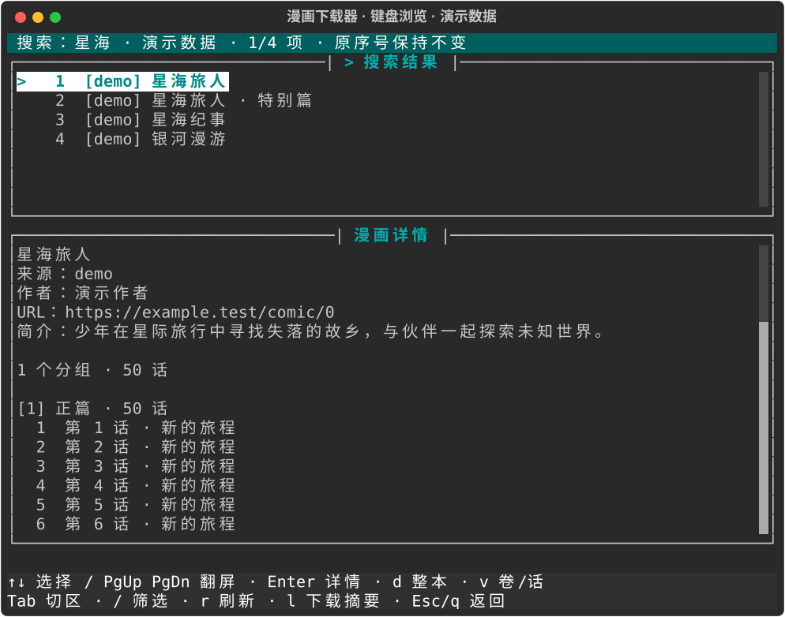

# Basic Usage

## 1. 启动工具

打开终端运行：

```bash
comic_downloader
```

或从源码启动：

```bash
uv run main.py
```

## 2. 搜索动漫

使用 `s` 命令搜索：

```bash
s one piece
```

工具会并行搜索所有启用的源，展示结果表格（含序号、源名称、作者、名称、URL）。
终端不足 80 列时仅展示序号、源名称和漫画名称；使用 `i <序号>` 查看完整信息。

交互式终端有搜索结果时会自动进入键盘浏览：

- `↑` / `↓` 选择高亮漫画，`Enter` 在同屏加载详情，`Tab` 切换列表和详情区。
- `PageUp` / `PageDown`、`Home` / `End` 浏览长列表与长目录。
- `d` 弹出整本下载确认框，默认选中取消。用 `Tab` 或左右键选“确认下载”后回车开始；`Esc` 取消。
- `/` 输入本地筛选，回车应用；编辑时 `d`、`q` 作为普通文字输入。`r` 刷新详情。
- 下载完成或普通失败后回到原浏览位置，`l` 查看最近一次下载摘要。
- `Esc` / `q` 返回命令行，`browse` 重新打开并保留筛选和高亮。

宽屏左右分栏，较窄屏上下分栏。小于 48 列或 18 行时单面板显示，`Tab` 切换；
下载需放大窗口或返回文本命令。详情按需请求、异步加载，最多缓存 20 本；退出会等待当前请求
结束并清理浏览器，因此耗时可能受网络超时及重试影响。



使用 `comic_downloader --plain` 关闭全屏浏览。直接子命令、管道和不支持控制的终端使用文本输出。
以下 `p`、`i`、`ch`、`d`、`v` 命令在返回命令行后输入。

搜索过程中逐源更新完成数量，结束后报告各源的结果数、耗时和状态：

- **有结果**：本次搜索完整执行并找到条目。
- **未检出**：本次没有找到条目；不能据此断言站点正常，可重试或改用漫画 URL。
- **部分结果**：保留已解析条目，并显示其余条目的解析错误。
- **失败**：显示网络、HTTP 状态或页面解析错误。
- **跳过**：源暂不支持搜索或浏览器未能启动，显示原因与后续操作。

已知搜索需要验证码的漫画站会提示使用 `i <完整漫画URL>`。
`status` 可再次查看最近一次搜索报告。

每次搜索会清除之前的结果，保留各源本次返回的全部条目，交互模式每页显示 20 条：

```text
p 2                    查看第 21～40 条
i 21                   查看原序号为 21 的漫画
p                      重新显示第 1 页
```

翻页使用会话缓存，不发起网络请求，不改变序号，也不会自动请求网站的后续搜索页。

## 3. 查看动漫详情

使用 `i` 命令查看详情：

```bash
i 1
```

或直接传入 URL：

```bash
i https://www.dumanwu.com/manhua/12345/
```

详情页展示漫画元数据和章节列表（按分组展示）。
交互模式每个分组先显示前 60 话，长列表通过 `ch` 翻页：

```text
ch 1 2                 查看第 1 分组的第 61～120 话
v 1 61 65              下载原序号为 61～65 的话
```

章节翻页不重新加载详情。省略页码时显示该分组第 1 页。

## 4. 选择源（可选）

通常工具会根据搜索结果或 URL 自动匹配源。如需手动切换下载源：

```bash
source
```

输入对应序号或源名即可切换，回车或 `q` 取消。也可以直接运行 `source dumanwu`
或 `source 2`。源列表显示当前选中项和下载是否需要浏览器；这表示配置能力，不代表实时可用性。

`s` 始终搜索所有启用源。切换源后旧漫画详情失效，但搜索结果序号保留。
请重新使用 `i <序号/URL>` 查看需要下载的漫画。

## 5. 下载动漫

### 全量下载

浏览界面中按 `d` 并确认，等价于命令行 `d <高亮漫画原序号>`，下载所有分组中的全部可解析章节，
无需提前加载详情。确认框会显示来源、URL、保存路径及覆盖策略。

```bash
d 1
```

或直接传入 URL：

```bash
d https://www.dumanwu.com/manhua/12345/
```

不传参数时下载当前查看的动漫：

```bash
d
```

### 范围下载

先查看详情获取章节列表，再使用 `v` 命令。

浏览界面的详情仅用于预览；请返回命令行执行 `i <原序号>` 后再使用 `v`。

详情中的“分组”对应章节序号；分组和话的序号均从 1 开始，范围包含截止话。
新的详情请求失败时会清除旧详情，避免后续下载误用旧漫画。

三种模式：

- `v <章节序号>` — 下载该章节下所有话
- `v <章节序号> <截止序号>` — 从章节开头到截止序号
- `v <章节序号> <起始序号> <截止序号>` — 指定起始到截止范围

示例：下载第 1 个章节的第 5 到 10 话：

```bash
v 1 5 10
```

### 直接 CLI 子命令

不进入交互式 shell：

```bash
comic_downloader search 猎人
comic_downloader info https://www.dumanwu.com/manhua/12345/
comic_downloader download https://www.dumanwu.com/manhua/12345/
comic_downloader download_vols https://... 1 5 10
comic_downloader tasks
comic_downloader retry <任务ID>
```

直接子命令的 `info` 和 `download` 必须使用 URL，不能使用交互会话中的搜索结果序号。
直接 `search` 和 `info` 会输出完整列表；`p` / `ch` 只用于交互会话。
缺少参数、多余参数、未知选项和无效范围会在加载源之前报错。

退出码可用于自动化脚本：`0` 成功；`1` 执行/配置失败（包括部分下载失败和空下载）；
`2` 参数错误；`130` Ctrl+C 中断。搜索至少一个源完整执行成功即返回 0（包括未检出）；
所有源失败或跳过、只有部分结果且没有完整成功的源时返回 1。已解析条目仍会保留并显示。

## 6. 下载行为

- 图片下载完成后自动打包为 ZIP
- 已有 ZIP 通过可读性、非空和 CRC 校验后跳过（除非使用 `--overwrite`）
- 下载失败自动重试（可配置次数）
- 浏览器驱动仅在源需要时初始化
- 失败后使用 `retry <任务ID>`，默认复用已下载图片，仅继续未完成章节
- ZIP 完整写入临时文件后才替换目标，不会把中途中断的打包结果作为最终 ZIP
- 打包仅包含预期的编号图片，不会把笔记或残留临时文件算作已下载图片

随时输入 `status` 查看保存路径、当前漫画、源、搜索结果数和覆盖模式。
输入 `help` 查看完整操作流程，`help v` 查看范围下载说明。

### 任务历史和程序重启后恢复

获取章节计划后，每次下载会显示任务 ID，并将所选分组、章节和进度保存在
下载路径的 `.comic_downloader/jobs/` 中。每话完成后更新一次记录。

```text
tasks                  查看任务列表、完成数量和状态
tasks <任务ID>          查看漫画、源、章节状态与失败原因
retry <任务ID>          继续失败、部分失败或未开始的章节
```

任务 ID 支持至少 4 位的不重复前缀；任务列表展示前 12 位。中断或重启后，
指定原来的保存路径启动程序即可继续，恢复时不需要重新搜索或获取漫画详情。
例如 `comic_downloader D:\Comics retry a1b2c3d4`，将 ID 替换为实际值。

成功和已跳过的章节保持不变。`retry` 使用当前运行配置和 `--overwrite` 选项，
覆盖只作用于未完成章节；要重新下载已成功的章节，请创建新的下载任务。
恢复后的汇总是整个任务的累计结果，包含此前完成的章节。

“未结束”表示上次记录处于执行中，可能是仍在运行，也可能是进程被终止。
可以运行 `retry`：仍在运行的任务会提示占用，进程退出后的锁由系统释放。
某条任务记录损坏不会隐藏其他任务；任务使用的源不再可用时，会提示检查源配置。

任务恢复依据历史结果，不会重新验证记录中已成功的文件；手动删除文件后请新建下载任务。
ZIP 的 CRC 校验用于识别归档损坏，不等同于图片内容的解码检查。

### 已完成计划归档、查找与恢复

```text
tasks completed                  找到已完成计划
archive a1b2c3d4                  归档单个计划，请替换为实际 ID
archive find 猎人 morui           按漫画名、源代码或 ID 查找归档
archive next                      保留关键词，查看下一页
archive prev                      查看上一页
archive show a1b2c3d4             查看归档章节，之后 next/prev 翻看章节
archive restore a1b2c3d4          恢复单个计划到任务列表
archive                           清除查找条件，回到全部归档首页
```

查找忽略大小写，按空白分词且所有词必须匹配，可跨字段命中。归档列表每页 20 项，章节详情每页
30 话；无匹配、参数错误和越界都会给出提示。查看详情后，连续翻页作用于详情；返回列表可重新
输入 `archive find <关键词>`。查找只影响浏览，归档和恢复始终针对指定的单个 ID。
归档保留计划内容及漫画文件；恢复不会自动重新下载。

直接 CLI 使用明确页码，例如 `comic_downloader D:\Comics archive list 2 find 猎人 morui`。
输出的翻页命令保留关键词；`archive next/prev` 只用于交互会话。

## 7. 退出

```bash
q
```

也可以通过 EOF 退出（Windows: Ctrl+Z 后回车；Unix: Ctrl+D）。直接回车不会重复执行命令。
解析或网络异常会显示错误并返回提示符，详细日志位于 `comic_downloader.log`。

## 浏览器模式说明

- **requests**: 纯 HTTP 请求模式，速度最快，无需浏览器。适用于无反爬或低反爬的网站。
- **SeleniumBase**: 使用浏览器 CDP 协议渲染页面，可处理 JavaScript 渲染和基本反爬。首次使用会自动下载匹配的 ChromeDriver。
- **CloakBrowser**: 基于 Playwright 的反爬浏览器，支持指纹伪装和代理。需要额外安装 `cloakbrowser` 包。

源可能配置自动回退（requests → SeleniumBase），在请求被屏蔽时无缝切换。

## 8. 运行配置文件

启动时可以用 `-c` 或 `--config` 指定运行配置文件：

```bash
comic_downloader --config configs/runtime.sample.json
```

配置文件可以覆盖启用的动漫源和运行时 `browser_mode`。示例文件见
`configs/runtime.sample.json`。其中 `sources.<源名>.enabled` 会覆盖
`downloader/sources/registry.py` 中的默认启用状态；`sources.<源名>.browser_mode`
会写入该源的 `SourceProfile`，优先级高于单站点 `configs/*.json` 中的
`browser_mode`，但不会修改源类本身：

```json
{
  "sources": {
    "morui": {
      "enabled": true,
      "browser_mode": "seleniumbase"
    },
    "maofly": {
      "enabled": false,
      "browser_mode": "requests"
    }
  }
}
```
